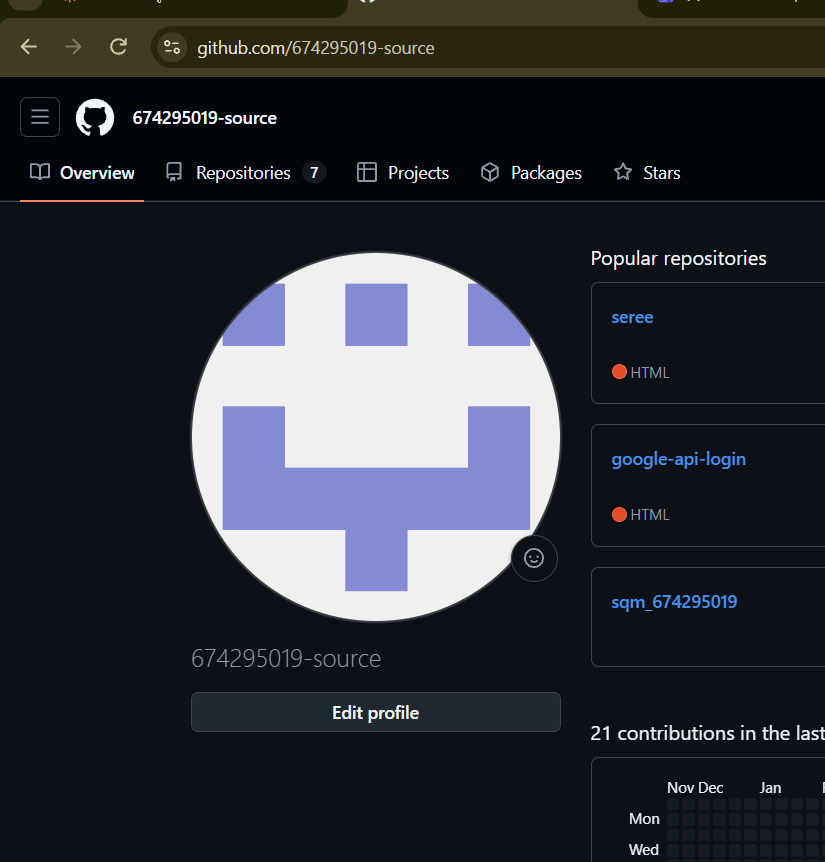
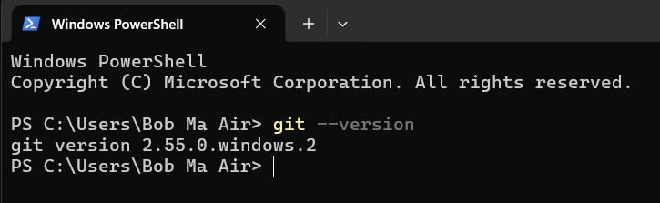
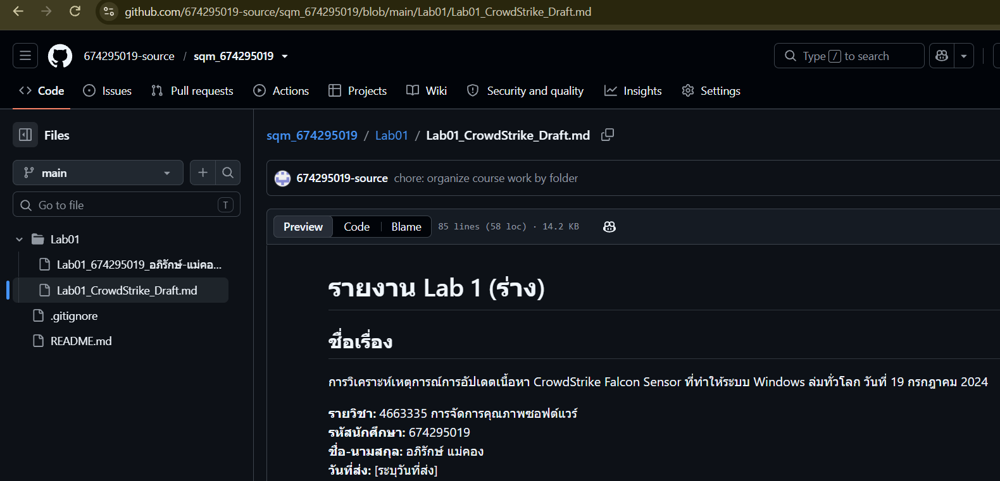

# รายงาน Lab 1 (ร่าง)

## ชื่อเรื่อง

การวิเคราะห์เหตุการณ์การอัปเดตเนื้อหา CrowdStrike Falcon Sensor ที่ทำให้ระบบ Windows ล่มทั่วโลก วันที่ 19 กรกฎาคม 2024

**รายวิชา:** 4663335 การจัดการคุณภาพซอฟต์แวร์ 
**รหัสนักศึกษา:** 674295019 
**ชื่อ-นามสกุล:** อภิรักษ์ แม่คอง 
**วันที่ส่ง:** [ระบุวันที่ส่ง]

> หมายเหตุ: เอกสารนี้เป็นร่างสำหรับทำงาน ควรตรวจสอบใบงานและ Rubric ของ Lab 1 ใน MS Teams ก่อนจัดทำเป็น PDF ฉบับส่ง

## 1. กรณีซอฟต์แวร์ล้มเหลวจริง: เหตุการณ์และผลกระทบ

วันที่ 19 กรกฎาคม 2024 เวลา 04:09 UTC บริษัท CrowdStrike ได้ปล่อยการอัปเดตการตั้งค่า Rapid Response Content สำหรับ Falcon Sensor บนระบบ Windows โดยมีวัตถุประสงค์เพื่อเก็บข้อมูล telemetry เกี่ยวกับเทคนิคการโจมตีรูปแบบใหม่ที่อาจเกิดขึ้น อย่างไรก็ตาม เครื่อง Windows ที่ได้รับเนื้อหาการอัปเดตที่มีปัญหาเกิดอาการจอฟ้า หรือ Blue Screen of Death (BSOD) เหตุการณ์นี้กระทบเครื่อง Windows ที่ใช้ Falcon Sensor เวอร์ชัน 7.11 หรือใหม่กว่า ซึ่งออนไลน์และได้รับการอัปเดตในช่วง 04:09-05:27 UTC CrowdStrike ย้อนกลับการอัปเดตที่ผิดพลาดเมื่อเวลา 05:27 UTC ส่วนเครื่อง Mac และ Linux ไม่ได้รับผลกระทบ

เหตุการณ์นี้มีความรุนแรง เนื่องจาก Falcon Sensor ถูกติดตั้งบนคอมพิวเตอร์ปลายทางของหลายองค์กร เมื่อคอมพิวเตอร์ล่ม บุคลากรไม่สามารถใช้งานระบบธุรกิจตามปกติ และอาจกระทบต่อบริการสำคัญที่พึ่งพาเครื่องเหล่านั้น กรณีนี้จึงแสดงให้เห็นว่า ข้อบกพร่องของซอฟต์แวร์อัปเดตที่เผยแพร่อย่างกว้างขวางสามารถกระจายผลกระทบอย่างรวดเร็วและทำให้การดำเนินงานของหลายองค์กรหยุดชะงักได้

## 2. คุณลักษณะคุณภาพที่เกี่ยวข้อง

| คุณลักษณะคุณภาพ | หลักฐานจากเหตุการณ์ | ความสำคัญ |
|---|---|---|
| ความน่าเชื่อถือ (Reliability) | การอัปเดตเนื้อหาทำให้เกิด exception ที่ไม่คาดคิดและระบบ Windows ล่ม | ซอฟต์แวร์ควรทำงานตามหน้าที่โดยไม่ล้มเหลวภายใต้เงื่อนไขที่กำหนด |
| ความพร้อมใช้งาน (Availability) | เครื่องที่ได้รับผลกระทบไม่สามารถทำงานต่อได้หลังได้รับการอัปเดต | ผู้ใช้ไม่สามารถเข้าถึงบริการหรือทำงานได้ในช่วงที่เครื่องไม่พร้อมใช้งาน |
| ความเข้ากันได้ (Compatibility) | การอัปเดตส่งข้อมูลเข้า 21 ฟิลด์ ในขณะที่ sensor คาดไว้ 20 ฟิลด์ | ส่วนประกอบที่แลกเปลี่ยนข้อมูลการตั้งค่าต้องจัดการรูปแบบข้อมูลที่ตกลงกันได้อย่างถูกต้อง |
| ความมั่นคงปลอดภัยและความยืดหยุ่น (Security / Resilience) | การอัปเดตจากซอฟต์แวร์รักษาความปลอดภัยกลับทำให้เครื่องปลายทางที่ปกป้องอยู่ใช้งานไม่ได้ | ผลิตภัณฑ์ด้านความปลอดภัยต้องรักษาเสถียรภาพของระบบไปพร้อมกับการป้องกันภัยคุกคาม |
| การกู้คืน (Recoverability) | ต้องนำเนื้อหาที่ผิดพลาดออกหรือย้อนกลับก่อนจึงทำให้เครื่องกลับมาใช้งานได้ | ระบบต้องมีกลไกกู้คืนและ rollback ที่ปลอดภัยและรวดเร็วเมื่อการปรับใช้ล้มเหลว |

## 3. จุดในวงจรการพัฒนาซอฟต์แวร์ที่ควรป้องกันหรือตรวจพบปัญหา

### การป้องกัน

1. **การเก็บความต้องการและการออกแบบ:** กำหนดและบังคับใช้กติกา data contract ที่ชัดเจนระหว่าง content configuration กับ sensor ต้องตรวจสอบจำนวน ชนิด และขอบเขตที่ยอมรับได้ของฟิลด์ข้อมูลก่อนเผยแพร่
2. **การพัฒนา:** เพิ่ม bounds checking และการจัดการข้อผิดพลาดเชิงป้องกัน เพื่อไม่ให้เนื้อหาที่รูปแบบผิดหรือไม่คาดคิดทำให้ระบบระดับ kernel ล่ม
3. **การทดสอบ:** ใช้ automated schema validation, unit test และ integration test สำหรับกรณีขอบเขต, fuzzing, fault injection และ rollback test กรณีทดสอบที่มีจำนวนฟิลด์ไม่ถูกต้องควรล้มเหลวก่อนถึงระบบจริง
4. **การวางแผนการเผยแพร่:** ประเมินความเสี่ยงของการปล่อย configuration ให้เครื่องจำนวนมาก และกำหนดให้มีการปล่อยแบบเป็นขั้น รวมถึงแผน rollback ที่ผ่านการทดสอบแล้ว

### การตรวจพบก่อนเกิดผลกระทบในวงกว้าง

1. ปล่อยการอัปเดตให้กลุ่ม canary ขนาดเล็กก่อน แทนการปล่อยให้ทุกเครื่องที่เข้าเกณฑ์ทันที
2. เฝ้าระวังอัตราการล่ม ความสำเร็จของการบูต และสุขภาพของ sensor/ระบบในแต่ละ deployment ring
3. หยุดการปล่อยโดยอัตโนมัติเมื่อระบบเฝ้าระวังตรวจพบความผิดปกติของการล้มเหลว
4. ให้ release notes ที่ชัดเจนและเครื่องมือควบคุมการปรับใช้ เพื่อให้ลูกค้าเลือกเวลาและขอบเขตการติดตั้งอัปเดตได้

## 4. การเปรียบเทียบ QA และ QC ในกรณีนี้

| ด้าน | ตัวอย่างสำหรับกรณี CrowdStrike |
|---|---|
| QA - การป้องกันที่มุ่งเน้นกระบวนการ | กำหนด governance สำหรับการปล่อยรุ่น กำหนดเกณฑ์ตรวจสอบไฟล์ configuration ทำ independent review และใช้นโยบายปล่อยแบบเป็นขั้น |
| QC - การตรวจหาข้อบกพร่องที่มุ่งเน้นผลิตภัณฑ์ | ทำ automated validation, boundary test, integration test, เฝ้าระวังการล่ม และตรวจสอบจากการปล่อยแบบ canary กับอัปเดตจริง |

QA ช่วยลดโอกาสที่การอัปเดตไม่ปลอดภัยจะผ่านการอนุมัติให้เผยแพร่ ส่วน QC ช่วยตรวจพบการอัปเดตที่ไม่ถูกต้องหรือพฤติกรรมที่เป็นอันตราย ก่อนกระจายไปยังเครื่องทั้งหมดในระบบจริง ทั้งสองส่วนมีความจำเป็นร่วมกัน

## 5. แนวทางปรับปรุงที่เสนอ

1. ตรวจสอบจำนวนและโครงสร้างของทุก configuration field ก่อนเผยแพร่
2. ใช้ bounds checking ใน content interpreter และจัดการเนื้อหาที่ไม่ถูกต้องอย่างปลอดภัย
3. กำหนดให้มี automated regression test สำหรับทุก template และ configuration type
4. ใช้ deployment ring แบบค่อยเป็นค่อยไป: ทดสอบภายใน, กลุ่มลูกค้า canary, ปล่อยแบบจำกัด และจึงขยายวงกว้าง
5. เฝ้าระวัง deployment telemetry และหยุดการปล่อยอัตโนมัติเมื่อค่าบ่งชี้การล่มเกินเกณฑ์
6. ทดสอบขั้นตอน rollback อย่างสม่ำเสมอและจัดทำ recovery runbook

ข้อเสนอเหล่านี้สอดคล้องกับแนวทางที่ CrowdStrike รายงานว่าจะดำเนินการ ได้แก่ การเพิ่มความเข้มงวดของขั้นตอนทดสอบและการตรวจสอบ การเพิ่ม bounds checking และการใช้ deployment ring ที่มี acceptance check

## 6. หลักฐาน GitHub และ Git

### ภาพที่ 1 หน้าโปรไฟล์ GitHub

ภาพแสดงบัญชี GitHub ของผู้จัดทำ ชื่อผู้ใช้ `674295019-source`

### ภาพที่ 2 ผลการตรวจสอบเวอร์ชัน Git

คำสั่ง `git --version` แสดงว่าเครื่องติดตั้ง Git เวอร์ชัน 2.55.0.windows.2 แล้ว

### ภาพที่ 3 Repository และไฟล์งาน Lab 1

ภาพแสดง repository `sqm_674295019` ของบัญชี `674295019-source` และโฟลเดอร์ `Lab01` ที่เก็บไฟล์งาน

## เอกสารอ้างอิง

1. CrowdStrike. (2024, August 6). *Executive Summary: Root Cause Analysis - Channel File 291*. https://www.crowdstrike.com/wp-content/uploads/2024/08/Executive-Summary_Root-Cause-Analysis_Channel-File-291.pdf
2. CrowdStrike. (2024, July 24). *Preliminary Post Incident Review: Content Configuration Update Impacting the Falcon Sensor and the Windows Operating System (BSOD)*. https://www.crowdstrike.com/en-us/blog/falcon-content-update-preliminary-post-incident-report/

## บันทึกการใช้ AI (กรอกเมื่อใบงาน Lab 1 กำหนด)

**เครื่องมือที่ใช้:** OpenAI Codex 
**คำถาม/งานที่สั่ง:** ขอให้ช่วยค้นหาแหล่งอ้างอิงที่น่าเชื่อถือและจัดโครงวิเคราะห์เหตุ CrowdStrike ล่ม โดยใช้แนวคิดด้านคุณภาพซอฟต์แวร์ 
**การนำผลลัพธ์ไปใช้:** ใช้เป็นแนวทางจัดโครงร่างและร่างเนื้อหาเท่านั้น โดยตรวจสอบข้อเท็จจริงและเอกสารอ้างอิงกับรายงานเหตุการณ์ของ CrowdStrike แล้ว 
**สิ่งที่ผู้จัดทำตรวจสอบหรือแก้ไขเอง:** [ระบุสิ่งที่ตรวจสอบ ปรับแก้ หรือเพิ่มเติมด้วยตนเอง]
